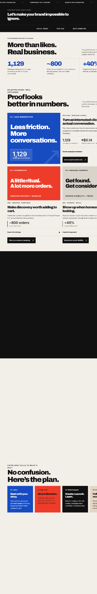

# SJPortfolio

Seren J’s responsive, single-page digital marketing portfolio showcasing creative strategy, social media, paid advertising, search visibility, selected work, and a contact enquiry flow.

**Live website:** https://jfuix.github.io/SJPortfolio/

## Portfolio preview

<a href="https://jfuix.github.io/SJPortfolio/">
  
</a>

## Features

- Editorial hero with layered typography and a portrait
- Selected work and service highlights
- Process and approach sections
- Responsive layouts for mobile, tablet, and desktop
- Light and dark color schemes, including system preference support
- Reduced-motion accessibility support
- Contact form that prepares an email in the visitor's mail application

## Tech stack

- HTML5
- CSS3 (`styles.css`)
- Vanilla JavaScript (`script.js`)
- Google Fonts
- GitHub Pages

## Project structure

```text
SJPortfolio/
├── index.html   # Semantic page markup
├── styles.css   # Styling, themes and responsive layouts
├── script.js    # Contact enquiry behavior
├── assets/      # Portfolio images and media
└── README.md    # Project documentation
```

Portfolio images, including the hero portrait, are stored in the `assets/` directory.

## Run locally

Clone the repository and open `index.html` in a browser. No package installation or build step is required.

## Theme preview

The page follows your operating system's color-scheme preference. To preview a theme temporarily, open the browser's developer console and run:

```js
document.documentElement.setAttribute('data-theme', 'dark');
// Or:
document.documentElement.setAttribute('data-theme', 'light');
// Restore automatic system preference:
document.documentElement.removeAttribute('data-theme');
```

## Maintenance

- Edit content and markup in `index.html`.
- Edit styling in `styles.css` and contact behavior in `script.js`.
- Responsive breakpoints and theme styles are in `styles.css`.
- The contact button uses `mailto:`; it does not submit to a server or store enquiries.
- Changes pushed to the default branch are published through GitHub Pages, subject to deployment delay.

## Quality checks

The source has been reviewed for duplicate HTML IDs, broken internal anchor targets, missing image alternative text, viewport metadata, and contact-form field references. Responsive and dark-mode rules are present. **Visual browser testing across devices and color schemes is still recommended** before treating the design as fully verified.

## License

No license has been specified. All rights reserved unless a license is added by the repository owner.
